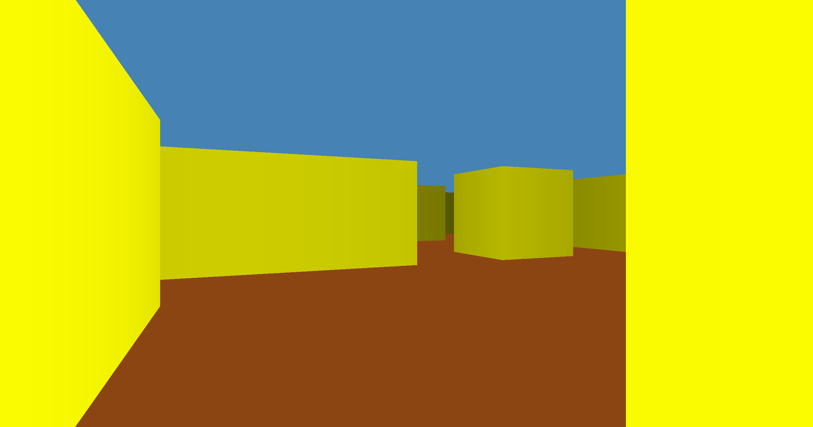

<div align="center">

# 🧱 Raycasting

**Реализация псевдо-3D рендеринга на основе техники бросания лучей (Raycasting)**


</div>

## 📄 Описание

Этот проект представляет собой собственную реализацию классического псевдо-3D рендеринга (в духе *Wolfenstein 3D*) на **Python** и **Pygame-CE**.

В основе лежит алгоритм **DDA (Digital Differential Analyzer)** для быстрого поиска пересечений лучей со стенами на двумерной сетке, а также математическая коррекция оптического искажения ("рыбьего глаза»).

## 📌 Скриншоты



## ✨ Возможности

* ⚡ **Алгоритм DDA** - быстрый и точный расчёт столкновений лучей со стенами без фиксированного шага.
* 👁️ **Коррекция "рыбьего глаза»** - проекция расстояний на плоскость камеры для устранения искажений перспективы.
* 🎮 **Плавное управление** - перемещение по карте и вращение камеры в реальном времени.
* 🧱 **Отрисовка сцены** - рендеринг стен с учётом расстояния и стороны столкновения.

## 🚀 Запуск

### 1. Клонировать репозиторий

```bash
git clone https://github.com/ksredkin/raycasting
cd raycasting
```

### 2. Установить зависимости

```bash
poetry install --only main
```

### 3. Запустить проект

```bash
poetry run python3 -m src.raycasting
```

## ⭐ Поддержка

Если проект оказался интересным или полезным - поставьте ⭐ на GitHub!
